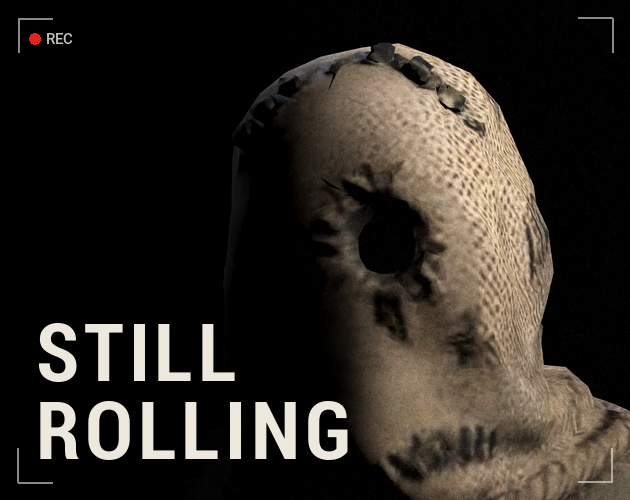

# Still Rolling: development log

**Still Rolling** is a first-person horror game for one to five players, made in four days for the
**2026 Epic AI MegaJam** (theme: "Director's Cut") by the one-person team **SoloTake**, with Unreal Engine 5.9.

1974. Vane House, 9 Marrow Lane. Edgar Vane never finished his home movie, *Our Happy Home*. You go in with a camera to
find its reels and splice an ending at his table in the cellar. He is still in the house, and he decides when a take is
over.

This repository is the public record of how the game was made. It holds no game code.

| File | What it is |
|---|---|
| [DEVLOG.md](DEVLOG.md) | The full development log, written during the jam, entry by entry: what was built, by which agent, how it was checked, what failed and what was cut. |
| [ASSETS.md](ASSETS.md) | Every model, texture, sound, font and voice in the game, with the tool or source that made it and the terms it is used under. |

## How it was made

One person directed a team of AI coding agents. The owner set the goals, played the builds, chose the designs and decided
what went in and what was cut. The agents wrote the code, built the house through the Unreal editor's Model Context
Protocol server, generated or drew the art and sound, wrote the tests and kept this log. Every result was looked at in
frames and checks before it was committed.

The log is long because nothing was left out: failed runs, reverted fixes, frame rates that missed their bar, tool
credits spent, and the things nobody had verified at the time are all written down where they happened.

## Tools

- **Unreal Engine 5.9** (MegaJam Preview), with its MCP server.
- **Claude Code** (Anthropic; Claude Fable 5.2 and Claude Opus): all C++, editor scripts, procedural textures and sounds,
  tests, packaging and this log.
- **Tripo Studio**: the three creatures, props, rigging, preset animations, concept images.
- **Meshy** and **Meshy's 3D Agent**: props, the teammates' body, the home-movie frames, the family photographs and
  paintings, the mansion's gothic front and its grounds.
- **Google AI Studio, Gemini speech generation**: every spoken line.
- **PBRgen**: surface materials.
- **Freesound**: 56 recordings under Creative Commons 0 (each listed in `ASSETS.md`).
- Python with numpy and Pillow, Blender, Visual Studio Build Tools, Git, Epic Online Services (online rooms).

The complete list, with what each tool made, is in `ASSETS.md`.

## Reading notes

- Times are Jordan time (UTC+3). The contest period ran from Nov 12, 2026, 08:00 to Nov 16, 2026, 04:59.
- File paths in the log (`Source/...`, `Tools/...`, `Docs/...`) refer to the game's project repository, which is private.
- Commit hashes in the log are from that repository.
